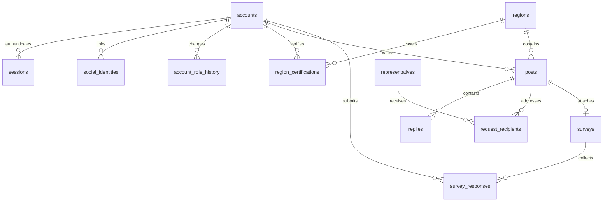

# DB 초기 스키마

기준: [확정 정책](../product-decisions.md), [DB 설계 제약](data-design-constraints.md).

## 관계

고정댓글은 `posts.pinned_reply_id` 하나로 표현합니다. `(post_id, reply_id)` 관계를 복합 외래 키로 검사하여 다른 글의 답글을 고정할 수 없습니다. 답글 부모도 같은 글에 속해야 하며, 생성 후 글·부모를 바꾸지 못하게 하여 순환을 막습니다. 단계 수 제한은 두지 않습니다.

## DB에서 검증하는 제약

| 영역 | 초기 제약 |
| --- | --- |
| 계정 | 현재 역할 enum 1개, 시민 닉네임 부분 고유 인덱스, 역할 변경 이력 |
| 소셜 계정 | 제공자·subject 고유. 이메일을 통합 키로 사용하지 않음 |
| 지역 | PostGIS 행정 경계·상위 지역 구조, 인증 결과만 저장, 1년 만료·최대 2개 슬롯 |
| 콘텐츠 | 글·답글 2,000자, 사진 배열 4개, 원 작성 계정·역할·소속 기록 보존, 수정 시각 |
| 시민 요청 | 수신 대표자별 별도 상태. 공식 답글 있는 요청의 물리 삭제 거부, 삭제 표시 시 본문·사진·링크 제거 |
| 고정댓글 | 글당 1개, 같은 글의 답글만 참조, 숨김·삭제 시 고정 해제 |
| 설문 | 공식 작성 스냅샷의 의견 요청에만 연결, 게시 후 정의 수정·분리 삭제 금지 |
| 응답 | 계정별 1개, 단일·복수 선택 검증, 현재 지역 인증 시민·마감 검증, 변경은 UPDATE로 교체 |
| 결과 | 마감 후 공개 글의 집계만 제공하는 view. 개인별 계정·선택 정보는 반환하지 않음 |
| 알림 | 팔로우별 알림 및 요청 유형별 설정 기본값 켜짐 |

## 권한 경계와 미구현 영역

DB 소유자·마이그레이션 계정은 신뢰하는 관리 주체입니다. 공개 요청을 소유자 자격으로 직접 처리하는 구조로 사용하면 안 됩니다. 초기 스키마는 PUBLIC 테이블·함수 권한을 회수하며 공개 쓰기 역할을 만들지 않습니다. 0002에서 해시 기반 세션과 역할 변경/정지에 따른 세션·공식 권한 회수를 추가했습니다. 서버 API는 세션과 객체별 권한을 검사합니다. 운영용 DB 역할·최소 권한 구성은 후속 운영 환경 작업입니다. 이 스키마만으로 모든 최종 사용자 권한이 구현되었다고 간주하지 않습니다.

서버에 연결한 사항: 글·댓글·고정댓글의 작성자/운영자 검사, 현재 역할·지역·공식 위임·임기·직원 재직 검사, 의원실의 직접 접수 확인, 마지막 공식 답변 삭제 시 해당 대표자 보류 전환. 아직 미구현: 실제 소셜 로그인·가입, 운영자 공식 심사·복구와 역할 변경 UI, GPS 실위치 인증·변경 간격, 이미지 저장소, 신고·AI 검토·알림 작업.

원본 GPS 좌표용 저장 컬럼은 없습니다. 좌표를 받는 향후 API도 요청 로그·오류 추적에 원본 좌표를 남기지 않아야 합니다.

## 적용과 테스트

마이그레이션: `db/migrations/0001_foundation.sql`, `0002_server_sessions.sql`. 회귀 검증: `db/tests/foundation.sql`. 실행 방법은 [개발 환경](development.md)을 따릅니다.

검증용 로컬 PostgreSQL 17.11·PostGIS 3.5.2에 적용했습니다. 시민 닉네임·역할 이력·지역 범위·2개 슬롯·PostGIS 거리·본문/사진 제한·고정 대상·설문 불변성·본문 수정·응답 변경·마감·공개 결과·인증 만료·공식 답변 보존을 확인했고 모든 테스트 데이터는 롤백했습니다. 동일한 마이그레이션의 재실행도 통과했습니다. 서버 경로는 `scripts/test-integration.ts`가 별도 임시 스키마에서 검증한 뒤 정리합니다.
